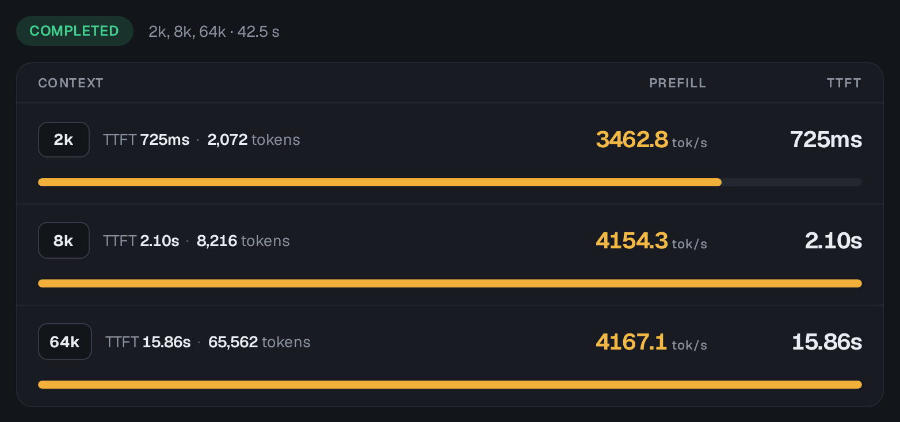
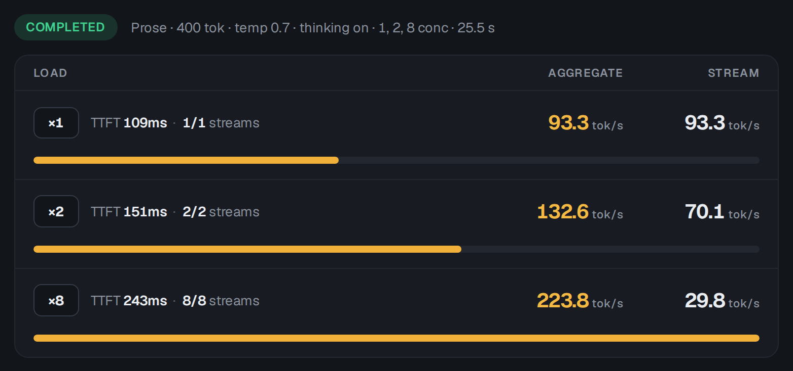
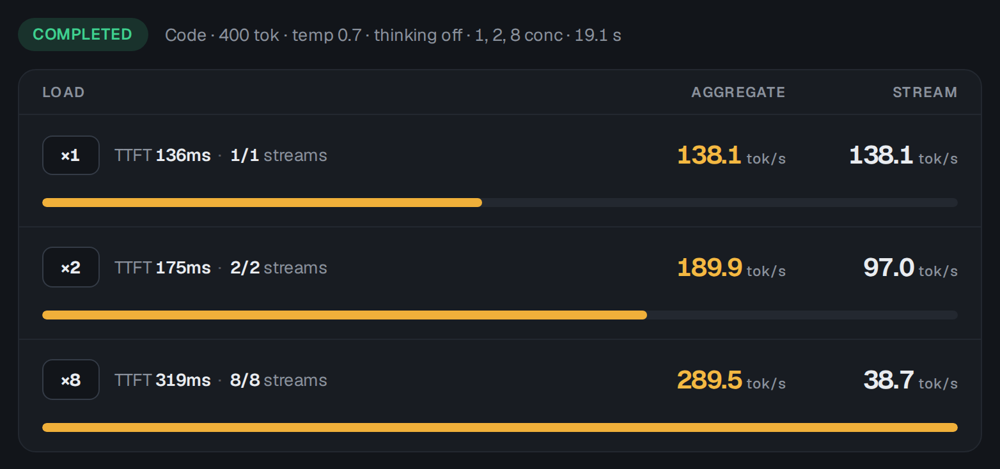

<h1 align="center">Vince GLM5.3 Flash</h1>

<p align="center">
  <sub>GLM-5.3-Flash EXL3 on four DGX Sparks in a switchless ring, with a faster prompt prefill.<br>
  A fork of <a href="https://github.com/MiaAI-Lab/GLM-5.3-Flash-EXL3-2x-DGX-Sparks-TensorFold">Mia's AI Lab's recipe</a>,
  on <a href="https://github.com/ashhart/TensorFold">TensorFold</a> by Ash Hart and its contributors.</sub>
</p>

Serve **GLM-5.3-Flash** from four NVIDIA DGX Sparks cabled to each other as a ring, without a switch, through an
OpenAI-compatible API: 8 concurrent requests, the model's 1,048,576-token context, image and video input. This is
[Mia's AI Lab](https://github.com/MiaAI-Lab)'s recipe
[GLM-5.3-Flash-EXL3-2x-DGX-Sparks-TensorFold](https://github.com/MiaAI-Lab/GLM-5.3-Flash-EXL3-2x-DGX-Sparks-TensorFold)
(branch `zig-engine` @ `697d8e9`, Apache-2.0) with one more image layer on top: her checkpoint, her TensorFold v0.6.0
Python engine with her 106 patches and her scripts are all used unchanged, and the layer changes 30 TensorFold files
so that a long prompt is read **about 70-85% faster** than her build reads it on the same four Sparks. It is for
people who already run, or want to run, Mia's four-Spark ring and send it long prompts: agents, documents, code bases.

| | Mia's stock build | This recipe, `exact` mode | This recipe, `fast` mode (default) |
|---|---:|---:|---:|
| Prefill, 32k-token prompt | 2,412 tok/s | 2,842 tok/s | **4,088 tok/s** |
| Replies | the reference | bit-identical to stock | not bit-identical; quality-checked |

Since v2.4 (2026-11-11) the layer also carries three GLM changes adapted from upstream TensorFold 1.2.6: verify
windows of 32 rows (a reply that repeats a file decodes about 28% faster), malformed tool calls that stay text, and
heat bands that pause a long prompt while the head Spark runs hot. No reply changes
([v2.4](#v24-what-tensorfold-126-has-for-glm-on-this-engine)).

Everything underneath is documented by Mia in [`README-Mia.md`](README-Mia.md): the ring's cabling and addresses, the
KV pool, vision, the API, every setting. Whose work each part is: [Credits](#credits) and
[`vince/CREDITS.md`](vince/CREDITS.md).

## Requirements

- **Four DGX Sparks** (GB10, 128 GB unified memory each) with nothing else large on their GPUs. With the default
  12,288-row prompt chunks rank 0's startup estimate is 57.7 GiB (53.5 with 6,144-row chunks); Mia's `start.sh` warns
  when a Spark has less free memory than her default needs.
- **A switchless ring:** each Spark's two ConnectX-7 ports cabled to its two neighbours, every cable its own subnet,
  the two Sparks across from each other routed through a neighbour, and key-based ssh from the head to the three
  workers. [`README-Mia.md`, "Without a switch"](README-Mia.md#without-a-switch-start-tp4-switchlesssh) has the
  cabling, the addresses, the routes and the link-speed check, step by step. On a switch this recipe's exchange does
  not apply (it is written for the ring).
- **The GPU clock every number here was taken at: a cap of 2,200 MHz** (the GPUs then run at about 2,190 MHz under
  load), on all four Sparks, with the CPUs' big cores capped at 2.8 GHz. That is this cluster's own choice, for heat
  and noise; Mia's README states the same 2,200 MHz cap for her two-Spark measurements. Without the caps your numbers will
  differ.
- Docker with the NVIDIA container runtime, `rsync`, and the disk Mia's recipe needs on every Spark (~205 GB:
  [`README-Mia.md`, "Requirements"](README-Mia.md#requirements)). This recipe's image layer adds little: 27 source
  files.

## Quick start

On the head Spark (rank 0, the one that serves the API):

```bash
git clone https://github.com/QuattroSparks/Vince-GLM5.3-Flash.git && cd Vince-GLM5.3-Flash

# 1. Your ring: the three workers as ssh targets, in the ring's order from the head
cp vince/local.sh.example scripts/local.sh
nano scripts/local.sh

# 2. First time only: Mia's image and the checkpoint (~176 GB) on all four Sparks. This serves Mia's stock build,
#    which is also your baseline to measure against.
VINCE_MODE=stock ./start-vince.sh

# 3. This recipe: builds its image layer on the four Sparks where it is missing, then (re)starts all four ranks
./start-vince.sh restart
```

It serves on `127.0.0.1:8000` as model `GLM-5.3-Flash-EXL3`. Then:

```bash
./vince/check.sh              # the running server against the saved replies and prefill figures
./stop-vince.sh               # stop all four ranks
DRY_RUN=1 ./start-vince.sh    # run the checks and print every rank's docker command; change nothing
./start-vince.sh --help
```

`start-vince.sh` checks `scripts/local.sh`, the mode, ssh to the three workers and the image
`tensorfold-glm53:vince-v2.4` on all four Sparks; where the image is missing, `vince/build-image.sh` builds it from
Mia's `tensorfold-glm53:v0.6.0` plus `vince/overlay`. Then it hands over to Mia's `start-tp4-switchless.sh`, which
checks the weights on every Spark, the ring, the port and the memory, starts the four ranks and waits for the first
reply. The first start on a new image also compiles its CUDA kernels. Exit codes: 0 serving, 2 settings, 3 a worker
cannot be reached over ssh, 4 the image could not be built; anything else is Mia's `start.sh`, whose message says why.

Mia's own commands (`./start-tp4-switchless.sh`, `./stop.sh`, `scripts/prepare.sh`) work in this folder too and read
the same `scripts/local.sh`.

## Results

One cluster of four DGX Sparks in a ring, GPU clocks capped at 2,200 MHz. Fixed prompts, one request at a time,
prompt-cache reuse off, `vince/tools/bench_prefill.py --seed 777`; tok/s is prompt tokens over the time to the first
token.

### Prefill

| Prompt | Mia's stock | `exact` mode | `fast` mode, v2.2 | **`fast` mode, v2.3 (default)** |
|---|---:|---:|---:|---:|
| 8k tokens | 2,098 tok/s | 2,627 (+25%) | 3,762 (+79%) | **3,877 (+85%)** |
| 16k | 2,322 | 2,818 (+21%) | 3,832 (+65%) | **3,980 (+71%)** |
| 32k | 2,412 | 2,842 (+18%) | 3,999 (+66%) | **4,088 (+69%)** |
| 64k | | | 3,973 | **4,087** |
| 128k | | | 3,984 | **4,020** |
| 195k needle (`tools/needle.py`) | | correct, 68.0 s | correct, 48.7 s | not re-run |

- **Fast mode, v2.3:** 2026-11-10 evening, all four GPUs at the 2,200 MHz cap (2,184-2,190 MHz read), median of 5
  runs a size ([`checks-v2.3-gate.txt`](vince/results/checks-v2.3-gate.txt), `prefill-v2.3-*.json`). The 8k and 16k
  rows are that session's 8,274- and 16,495-token prompts. v2.2's settings in the same session, on the same image,
  read 3,831 / 3,885 / 4,039 / 4,071 / 3,918.
- **Fast mode, v2.2:** as served that afternoon, all four GPUs at 2,190 MHz, median of 5 runs a size
  ([`prefill-v2.2-2190mhz.json`](vince/results/prefill-v2.2-2190mhz.json),
  [`checks-v2.2-2190mhz.txt`](vince/results/checks-v2.2-2190mhz.txt)). The needle is from v2.2's soak the same day
  ([`checks-v2.2.txt`](vince/results/checks-v2.2.txt)), when the head's GPU ran at about 2,275 MHz.
- **Stock and exact mode:** 2026-11-08, median of 3 runs, the same prompts (exact:
  [`prefill-exact.json`](vince/results/prefill-exact.json); the clock was not logged with those runs). Exact mode was
  measured as v1 and has not been re-measured since.
- **Mia's own published four-Spark figures** are 2,569 / 2,574 / 2,583 tok/s at 8k / 16k / 32k, measured with
  sparkDash on her ring ([`README-Mia.md`, "4 Sparks"](README-Mia.md#4-sparks-experimental)). The stock column above
  is her build on this cluster with this recipe's tool, so that all the columns share one yardstick; the two tools
  were not reconciled here.

**v2.4 measured with sparkDash 2.70.0** (Mia's AI Lab's dashboard, the tool behind her tables; 2026-11-11, cold
prompts, no cached tokens, 3 samples a size and 2 at 64k, [`sparkdash-v2.4-prefill.json`](vince/results/sparkdash-v2.4-prefill.json)):



| Prompt | Tokens | First token | sparkDash prefill, tok/s | Tokens / time to first token |
|---|---:|---:|---:|---:|
| 2k | 2,072 | 0.72 s | 3,463 | 2,859 |
| 8k | 8,216 | 2.10 s | 4,154 | 3,905 |
| 64k | 65,562 | 15.86 s | 4,167 | 4,134 |

sparkDash subtracts a calibrated request overhead (126 ms in this run) from the time to first token before it
divides; the last column divides by the whole time, as this recipe's own tools do, so it is the lower of the two.
Quote either with its method. On the same yardstick Mia's published four-Spark figure at 8k is 2,569 tok/s (her
ring, her day; not re-measured here).

**Short prompts** (v2.3's subject). Same session, same image, v2.2's settings against v2.3's, 5 runs a size, replies
identical:

| Prompt tokens | v2.2 first token, ms | v2.3 first token, ms | v2.2 tok/s | **v2.3 tok/s** |
|---:|---:|---:|---:|---:|
| 1,036 | 495 | 449 | 2,093 | **2,309** |
| 2,042 | 847 | 727 | 2,410 | **2,810** |
| 3,049 | 1,124 | 950 | 2,712 | **3,210** |
| 4,054 | 1,424 | 1,158 | 2,847 | **3,500** |
| 6,065 | 1,693 | 1,625 | 3,582 | **3,732** |
| 8,274 | 2,160 | 2,134 | 3,831 | **3,877** |
| 12,078 | 3,116 | 3,080 | 3,877 | **3,921** |
| 16,495 | 4,246 | 4,145 | 3,885 | **3,980** |
| 20,134 | 5,059 | 4,988 | 3,980 | **4,036** |
| 24,154 | 5,978 | 5,942 | 4,041 | **4,065** |

A forward pass costs about 105 ms however few rows it has, and a chunk's routed experts read their weights once per
half, so short prompts cannot reach the long prompts' rate: about 4,000 tok/s starts near 11k tokens and holds from
17k up (the soak in `checks-v2.3-gate.txt` has 21 more sizes, from 102 to 45k tokens).

How the versions got there, each measured in its own session (v2.2's column with the head's GPU at 2,288 MHz and the
other three at 2,190, while the clock cap was being tried higher one Spark at a time; it is back at 2,200):

| Prompt | fast, v1 | fast, v2 / v2.1 | fast, v2.2 (head at 2,288 MHz) |
|---|---:|---:|---:|
| 8k | 3,112 | 3,390 | 3,813 |
| 16k | 3,384 | 3,703 | 3,899 |
| 32k | 3,437 | 3,766 | 4,052 |
| 64k | 3,453 | 3,831 | 4,083 |
| 128k | 3,397 | 3,770 | 4,035 |

(`vince/results/prefill-default.json`, `prefill-v2*.json`, `prefill-v2.2*.json`.) With all four GPUs at 2,288 MHz
v2.2 read about 1% more at 32k-64k than with three of them at 2,190: prefill is mostly bound by memory, not by the
clock.

### Quality

`vince/tools/quality.py`, exact and fast (v1) mode:

| Check | exact | fast |
|---|---:|---:|
| 40 arithmetic problems, thinking on | 40/40 | 40/40 |
| 19 code-word recalls from 8k-64k documents | 19/19 | 19/19 |
| 60 arithmetic problems, thinking off (a fragile test) | 15/60 | 15/60 |

In exact mode every greedy reply is bit-identical to Mia's stock build. In fast mode, replies started by many users at
once are identical to the same replies run alone. v2, v2.1, v2.2, v2.3 and v2.4 leave fast mode's replies as v1's were (five fixed
greedy replies, alone and all at once, after every step; v2.3 also on 25 short prompts), which is why the suite was not run again for them.

### Decode

One request, measured 2026-11-10 on v2.1 (6 runs each, median and range; `vince/tools/rep.py`,
`vince/results/decode-v2.1-*.json`). Two yardsticks, because they use different prompts and clocks:

- **Ours** (`decode_check.py`, `conc_bench.py`): a creative story, temperature 0, thinking off, tok/s over the whole
  request (the short prompt's prefill and the first token included).
- **sparkDash's DecodeBench** (what Mia's README tables use): "explain how a hash map works", tok/s after the first
  token. A predictable explanation lets the DFlash2 drafts land 2.7 tokens a round, a story 1.95, and a round costs
  the same either way: that, not the build, is why this yardstick reads ~18 tok/s higher on the same server.

| One request, tok/s | v2 settings (all cores) | + `TF_GLM_DEC_CPUS=big` | + `TF_GLM_DEC_MSG=1` (**default**) |
|---|---:|---:|---:|
| ours: lighthouse story (`decode_check.py` prose) | 70.5 (67.8-71.1) | 72.1 (71.8-72.5) | **72.9 (72.7-73.2)** |
| ours: a different story each run, 256 tokens (`conc_bench.py` c1) | 68.6 (64.9-71.0) | 70.3 (69.0-74.8) | **71.0 (69.9-75.4)** |
| ours: code (`decode_check.py` code), 3 runs | 93.7 (88.2-94.0) | 95.9 (95.6-95.9) | **97.4 (97.3-97.6)** |
| sparkDash prose, temperature 0, thinking off (Mia's 2026-10-09 protocol) | 87.0 (84.3-87.4) | 89.1 (80.9-89.8) | **90.4 (90.0-90.7)** |
| sparkDash prose, its present defaults (temperature 0.7, thinking on) | 88.2 (87.9-88.8) | 90.3 (81.9-90.7) | **91.6 (91.5-91.9)** |

The last column is with fast mode's prefill switches on, as served. Both decode switches leave every reply as it was:
the five fixed greedy replies are identical, alone and all five at once, and the benchmark replies' token hashes and
round counts are the same in every column. On sparkDash's prompts at two requests v2.1 gives 142.2 prose / 193.1 code
in all (`decode-v2.1-both-yardsticks.json`). Mia's published four-Spark table reads 95.2 prose / 138.6 code at one
request and 133.2 / 185.1 at two; on her protocol this cluster's v1 build read 87.2 / 148.5 at one
(`decode-v1-live-both-yardsticks.json`), so at one request prose is below her table here, with or without this recipe.

**v2.4 on sparkDash's decode bench** (2026-11-11, 400 tokens a stream, temperature 0.7, one run,
[`sparkdash-v2.4-decode.json`](vince/results/sparkdash-v2.4-decode.json)):

| tok/s in all | 1 stream | 2 streams | 8 streams |
|---|---:|---:|---:|
| Prose (thinking on) | 93.3 | 132.6 | 223.8 |
| Code (thinking off) | 138.1 | 189.9 | 289.5 |




That is level with Mia's published table (95.2 / 138.6 at one request, 133.2 / 185.1 at two): this recipe's gain is
in prefill, not in decode. v2.4's own decode gain is for replies that repeat text they have seen
(`vince/tools/editbench.py`, one request, tok/s after the first token, 5 runs, replies identical):

| Reply | v2.3 (16-row windows) | **v2.4 (32-row windows)** |
|---|---:|---:|
| A 230-line file quoted back | 252 | **323-326** |
| The same file with one name changed | 244 | **311-316** |
| A story / new code (the ordinary case) | 75.4 / 101.6 | 74.3-74.7 / 99.7-100.5 |

The last row is one earlier v2.3 run against four v2.4 starts; `vince/check.sh` reads 72.9 / 97.9 on v2.4, the same as
v2.1's. Whether ordinary text lost about 1% was not separated from start-to-start variation.

### Concurrency

`vince/tools/conc_bench.py`, aggregate tok/s with c different prompts at once (one run each):

| c | prefill, stock | prefill, fast (v1) | prefill, fast (v2.2) | decode, stock | decode, fast (v1) | decode, fast (v2.2) |
|---:|---:|---:|---:|---:|---:|---:|
| 1 | 2,272 | 3,142 | 3,729 | 65.1 | 63.6 | 65.8 |
| 2 | 2,216 | 3,058 | 3,030 | 95.5 | 94.5 | 98.9 |
| 4 | 2,228 | 3,015 | 3,080 | 121.1 | 129.9 | 135.9 |
| 8 | 2,212 | 2,995 | 3,090 | 161.4 | 165.8 | 166.0 |

Several prompts at once run as one multi-prompt chunk, which v2's and v2.2's switches (they act on a lone prompt's
halves) do not speed up: their gain is for one prompt at a time.

## Optional: speech-to-text for a voice chat

`vince/extras/parakeet/install.sh` puts NVIDIA's Parakeet TDT 0.6B v3 on a worker Spark (never the head unless asked) behind an OpenAI-compatible
`/v1/audio/transcriptions`, so a voice client can send speech, pass the text to this server and speak the reply.
It is opt-in, starts nothing by default, listens on `127.0.0.1` unless told otherwise, and takes about 4.5 GiB of that
Spark's memory: [`vince/extras/parakeet/README.md`](vince/extras/parakeet/README.md).

## Modes

| `VINCE_MODE=` | Image | What is on | Replies |
|---|---|---|---|
| `fast` (default) | `vince-v2.4` | v2.4's 32-row verify windows and heat bands, the RoCE ring exchange, 12,288-row prompt chunks, four prompt-precision switches, the eight same-bits prefill switches of v2 and v2.2, v2.3's three short-prompt settings, the two decode switches | **not bit-identical to Mia's stock build** |
| `exact` | `vince-v2.4` | v2.4's heat bands, the RoCE ring exchange, 6,144-row prompt chunks, the two decode switches | bit-identical to stock |
| `stock` | Mia's `v0.6.0` | nothing: Mia's build and settings | the reference |

**Fast mode's replies are not bit-identical to Mia's stock build.** Four switches (`TF_GLM_PF_FP8`,
`TF_GLM_PROMPT_PARTIALS=bf16`, `TF_GLM_MSA`, `TF_GLM_PF_EY16`) change the rounding of prompt arithmetic, so a greedy
reply can differ from stock's in its wording. They were adopted after the quality checks above; this recipe did not
measure a KL divergence against stock. **Exact mode's replies are bit-identical to stock**: it only changes how bytes
move between the Sparks and where threads run.

```bash
VINCE_MODE=exact ./start-vince.sh restart
TF_GLM_MSA=0 ./start-vince.sh restart          # one switch overridden: the environment wins over the settings files
```

The modes are defined in [`vince/modes.sh`](vince/modes.sh), which your `scripts/local.sh` sources. `.env` switches
on two of Mia's settings (`TF_GLM_LOOP_GUARD`, `TF_GLM_EFFORT_TAIL`) in every mode; the saved replies were recorded
with them on.

## What it changes

Six changes make v1. Three are options Mia's recipe already had, three are new. Gains are approximate, at 32k, each
measured on its own:

| Change | Setting | Origin | Gain |
|---|---|---|---:|
| Prompt chunks of 6,144 rows | `TF_GLM_PREFILL_ROWS=6144` | Mia's option | +2.4% |
| The row split's prompt exchanges over a RoCE ring exchange | `TF_GLM_PF_XCHG=1` | **new** | +15% |
| FP8 activations for the 4-bit dense prompt projections | `TF_GLM_PF_FP8=1` | **new** (TensorFold's FP8 kernels) | +5.8% |
| The row split's partial sums as bf16 | `TF_GLM_PROMPT_PARTIALS=bf16` | Mia's option | +3.6% |
| MSA | `TF_GLM_MSA=1` | Mia's option | ~+2% |
| The routed experts' prompt outputs as bf16 | `TF_GLM_PF_EY16=1` | **new** | +8.4% |

The first two keep every reply identical (exact mode). The last four change the rounding of prompt arithmetic (fast
mode).

### The RoCE ring exchange

Mia's row split divides a prompt chunk's hyper-connection glue between the four ranks by rows. In every layer, each
rank sends the others its fp32 partial sums for their rows and swaps the glued rows back. NCCL ran these exchanges as
two-rank all-gathers per link, at about 31% of what the cables carry.

The new exchange is an all-to-all mode added to a copy of [b12x](https://github.com/local-inference-lab/b12x)'s
RoCEnante proxy, which TensorFold already uses for decode and to which Mia's AI Lab added the ring relay:

- Each rank RDMA-writes its block straight into each neighbour's memory.
- The block for the rank across the ring goes half through each neighbour, whose proxy relays it (the design follows
  Andy Shu's dsgx10 and Christopher Owen's dgx-spark-networking).
- The relayed stripes are posted first, on the PCIe domain the forwarded stripe doesn't use, so both domains carry the
  same bytes.
- On the GPU it's three small launches: stage, a one-block wait, and copy. No NCCL kernels spin on SMs.
- The DSA layers' own-row shares get a second exchange on their own stream, so they never queue behind the bulk
  exchanges.

Each cable measured 196 Gb/s per direction alone, but only about 104 Gb/s each with all eight directions active (each
GB10's NIC carries about 26 GB/s per direction in all). That ceiling limits how much faster any exchange can get here.

### v2: five more switches, the same replies as v1's fast mode

They remove passes over memory and work that every rank repeated; no arithmetic changes. Each was measured on its own
against v1's settings in the same session (8k / 16k / 32k), with the five fixed greedy replies identical every time:

| Change | Setting | Gain |
|---|---|---:|
| A prompt chunk updates the DFlash2 drafter only with its last ring of rows (17 launches a 6,144-row chunk, not 48) | `TF_GLM_PF_TAP_TAIL=1` | +0.9 / +1.6 / +1.7% |
| Two passes nothing read (a copy before the FP8 quantize, unused group sums) | `TF_GLM_PF_LEAN=1` | +0.6 / +0.9 / +0.5% (within noise) |
| The bf16 partials written by the matmul / combine itself instead of fp32 plus a cast pass | `TF_GLM_PF_PART16=1` | +3.6 / +3.8 / +3.9% |
| The MoE router and top-k on each rank's own rows, the picks shipped with the rows | `TF_GLM_PF_OWN_ROUTER=1` | +1.8 / +2.5 / +2.2% |
| hc_post reads the peers' partials in the exchange's receive slots (no copy launch) | `TF_GLM_PF_ZC=1` | +1.1 / +1.6 / +1.6% |
| All five | | **+8.5 / +10.1 / +10.1%** |

The zero-copy receive was first run in a shadow mode on all four ranks (the usual path served, the new kernel's
output only compared): 0 differing elements over every hc_post of the 8k-32k benchmarks and the reply checks.

### v2.1: two decode switches, the same replies

A decode round is one verify forward on every rank (~90% of the round), one DFlash2 block and one message from rank 0
to the others. Neither switch touches the arithmetic; both are on in fast and exact mode.

| Change | Setting | Gain (story / sparkDash prose / code) |
|---|---|---:|
| Every thread of a rank runs on the GB10's ten big cores (5-9, 15-19). Left alone, Linux kept the round loop and the RoCE proxy's polling thread mostly on the small cores | `TF_GLM_DEC_CPUS=big` | +2.3 / +2.4 / +2.3% |
| A round's message to the other ranks goes as one 256-byte frame over the RoCE all-gather; before, its length and its values were two odd-sized gathers that fell back to NCCL (~0.6 ms a round) | `TF_GLM_DEC_MSG=1` | +1.1 / +1.7 / +1.8% |
| Both | | **+3.4 / +3.9 / +3.9%** |

The big-core idea is Christopher Owen's (his dgx-spark-networking keeps its proxy thread there); here it is an
affinity mask on the whole process. `TF_GLM_DEC_MSG` must be the same on every rank (the ranks compare it at start).
Other DFlash2 draft rules were measured and gave nothing: the default `fnc7:0.3` is already the optimum on four
Sparks.

### v2.2: larger chunks and three more switches, the same replies

Each step measured in one session against the step before, 5 runs a size, the five fixed greedy replies identical
after every one (32k figures, head GPU at 2,288 MHz):

| Change | Setting | 32k tok/s |
|---|---|---:|
| v2.1 | | 3,778 |
| Prompt chunks of 8,192 rows | `TF_GLM_PREFILL_ROWS=8192` | 3,858 (+2.1%) |
| Before a KDA layer each rank quantizes only its own rows and ships the FP8 bytes, group sums and scales instead of the bf16 rows (**new**) | `TF_GLM_PF_KQ=1` | 3,921 (+1.6%) |
| A row broadcast staged once in the exchange's send slot, not once a peer (**new**) | `TF_GLM_PF_XCHG_BCAST=1` | 3,938 (+0.4%) |
| A site's partial filled in one call (v1's dropped experiment, a gain now) | `TF_GLM_PF_FILL_WHOLE=1` | 3,959 (+0.5%) |
| Prompt chunks of 12,288 rows | `TF_GLM_PREFILL_ROWS=12288` | **4,052** (+2.3%) |

The routed experts read their weights once per half chunk, so larger chunks cost less per row. With 6,144-row chunks
the exchange was the limit on 2026-11-08 and larger chunks gained nothing then.

### v2.3: short prompts, the same replies

| Change | Setting | What it does |
|---|---|---|
| The last rows with the chunk before them (**new**) | `TF_GLM_PF_TAIL_MERGE=1` | A prompt that does not end on the 64-token grid ran a second forward for its last 1-63 rows (~100 ms). They now run in the same chunk; the state kept at the grid point for later turns is taken on the way (each KDA layer's recurrence runs as the two calls it made before, its state copied between them). -50 to -75 ms on every such prompt |
| Halves from 1,920 rows | `TF_GLM_PROMPT_MICROBATCH_MIN_ROWS=960` (Mia's option; her default is 2,048) | Chunks of 1,920-4,095 rows run as two halves too: -100 ms at 2k, -190 ms at 4k |
| Equal chunks (**new**) | `TF_GLM_PF_BALANCE=1` | A prompt longer than one chunk runs in equal chunks, not full ones and a short last one: +1 to +3% at 12.3k-24k |

Checks before it was saved (`checks-v2.3-gate.txt`): replies identical to v2.2's on the five long prompts and on a
new set of 25 short prompts (`vince/tools/short_ref.py`, `vince/results/replies-short.json`), alone and concurrent; a
follow-up turn that resumes from a kept state gets the same reply whether the state was kept by the two-chunk run or
by the merged chunk (`vince/tools/reuse2.py`); decode 72.0-72.4 prose / 96.2-96.6 code; a soak of 21 odd sizes and six
pairs at two requests with no error. Chunks that are not a multiple of 64 rows are padded to 16 rows at four ranks so
their exchange blocks stay on the RoCE path. Tried and left off: short chunks unsplit (slower: 1k tokens 440 -> 676
ms).

### v2.4: what TensorFold 1.2.6 has for GLM, on this engine

Upstream TensorFold (v1.2.6 and `main` to `6b739dd5`, 2026-11-11) was read for every GLM-on-CUDA change. On its own
four-Spark ring upstream reports cold 64K prompts in 36.5 s (about 1,750 tok/s) and decode at 75 code / 63 chat
(its recipe page, measurements by @Bizuayeu), so the engine was not swapped. What was missing here was taken:

| Change | Setting | What it does |
|---|---|---|
| 32-row verify windows (upstream #2257's width) | `TF_GLM_MAX_ROWS=32`, `COPY_MAX=31`, `WIDE_GRAPHS=16,32` (fast mode) | A round verifies up to 31 copied tokens, was 15. Mia's engine already had the code; `start.sh` capped `COPY_MAX` at 15 |
| Malformed tool calls stay text (upstream #2801 / #2831) | in the image | An `<arg_value>` that runs into the next `<arg_key>`, or never closes, no longer becomes a call with corrupt or missing arguments, whole and streamed |
| Heat bands (upstream `TF_HEAT_HIGH` / `TF_HEAT_LOW`) | `TF_GLM_HEAT_HIGH=78`, `TF_GLM_HEAT_LOW=72` (fast and exact; `0` / `0`: off) | The head holds a prompt's next chunk while its GPU reads above 78 C, until 72 C or less. Decode is never held. Three cold 93k prompts back to back: 4,079 / 4,084 / 3,909 tok/s, peak 79 C, 1.0 s waited in all |

Checks before it was saved ([`checks-v2.4-recipe-start.txt`](vince/results/checks-v2.4-recipe-start.txt)): replies
identical to the long and the short reference sets, alone and all at once; 32k prefill 4,109-4,115 tok/s; decode
72.9 prose / 97.9 code; a tool call; no error line and no thermal slowdown. The tool-call fix was checked on the CPU
with well-formed and malformed calls, whole and streamed character by character; no malformed call was provoked
from the live model.

Already here, or equivalent, so nothing to port: 16-row windows with a tuned DFlash2 rule, the experts' prefetch and
non-coherent loads, small gathers over RoCE, prompt rows split between the ranks, kept prompt states on a 64-token
grid. Read and not taken: upstream's multi-stream DFlash2 fix (#2793) repairs a pricing rule this engine does not
have; `TF_GLM_EXL3_DEC_ORDER=1` (patch 0090) measured no gain here; decode at a depth of 93k tokens is 72.1-72.3
tok/s against 74.3-74.7 at the start of a conversation, so upstream's wider selection at long positions (#1424) was
not ported.

### Also in the image, switched off

Measured slower or no faster here, or not measured yet; their code is in the overlay.

- A bit-exact dequantize-plus-Triton GEMM for the 4-bit projections (`TF_GLM_PF_GEMM`): -2.7%.
- The shared expert on whole rows: -4% (v1), -3% (v2.2). KDA projections overlapped with the other half's recurrence:
  -1.3%. 128-member expert passes: -4%. Micro-batches off: -10%.
- A site's fills written straight into the exchange's send slot (`TF_GLM_PF_SI`, after Christopher Owen's direct-stage
  idea): slower here, because it moves a copy from the side stream to the main one.
- The short last chunk in halves, more blocks for the exchange's copies, another FP8 matmul tile: no gain.
- The exchange proxy on the big cores (`TF_GLM_PF_XCHG_PROXY_CPU=big`) and a `dmb oshld` barrier in its relay
  (`TF_GLM_PF_XCHG_DMB=1`), both after Christopher Owen's dgx-spark-networking: **not measured yet**.
- Measurement aids: per-rank exchange timers (`TF_GLM_PF_XCHG_TIME=1`), an nsys capture of rank 0
  (`TF_GLM_PF_NSYS=1`, with `TF_GLM_DEC_TRACE=START:COUNT` for decode rounds).

## Checks

Every check sends ordinary requests to the running server on `127.0.0.1:8000` and restarts nothing. Run them while
the server is idle, because prompt-cache reuse is switched off for their duration.

- `vince/check.sh` checks the bits: greedy replies to five fixed prompts (short, 6k, 20k and 33k documents, and one
  with thinking) must equal the saved ones of this mode, both one at a time and all five at once. Then it runs a short
  decode check and the 8k, 16k and 32k prefill benchmark. `VINCE_MODE=exact vince/check.sh` compares with stock's
  replies.
- `vince/check.sh full` adds the quality suite, the concurrency table and the 195k needle.
- `vince/tools/xchg_test.py` is the exchange's own test: 320 exchanges, checked element by element on all four ranks
  inside the containers (`python xchg_test.py RANK MASTER PORT`).

The saved replies were produced by this cluster's build. On other Sparks the same image and settings should give the
same bits, but that has not been tried: if `check.sh` reports a difference on a healthy start, please open an issue
with its output.

## Limits and what is not verified

- **One cluster.** Everything was measured on one ring of four DGX Sparks. Nobody else has run this recipe yet.
- **A fresh install was not run end to end.** The Sparks it was built on already had Mia's image and checkpoint; the
  steps of "Quick start" from an empty machine follow Mia's documented flow but were not replayed.
- **Exact mode was not started again with the later switches.** Its bit-identity with stock was checked on v1
  (2026-11-08). The two decode switches of v2.1 are on in exact mode because they change no arithmetic, but exact
  mode was not booted with them, and its prefill figures are v1's.
- **The quality suite was not re-run after v1.** v2, v2.1, v2.2, v2.3 and v2.4 give replies identical to the build that
  passed it, so its results stand. The concurrency table and the 195k needle were last run on v2.2.
- **No KL divergence of its own.** Fast mode's distance from stock is known only through the quality checks above.
- **A 12,288-row start hung once**, on 2026-11-08, on v1. On v2.2 the same size ran a soak without a hang (18 prompts
  of odd sizes from 3k to 100k, the reply checks, the 195k needle, a tool call, the concurrency table). If a prompt ever hangs, the fallback is `TF_GLM_PREFILL_ROWS=8192` (-2% at 32k).
- **Heat.** Under back-to-back prompts at the 2,200 MHz cap the head Spark's GPU reaches 75-82 C and the workers
  65-77 C; the head's software thermal-slowdown counter moved at 78-82 C. The benchmark tools here therefore pause
  when any GPU reaches 75 C (`vince/tools/thermal.py`), and v2.3's figures count no thermal slowdown. With the cap at
  2,300 MHz all four reached 82-86 C and throttled, for about 1% more prefill; the cap went back to 2,200.
  Since v2.4 the server itself holds a prompt's next chunk while the head reads above 78 C (heat bands). They watch
  the head only: a worker that runs hot holds nothing (the workers peaked at 60-63 C in v2.4's check).
- **Memory headroom.** After a start of v2.4 the four Sparks had 19.3 / 17.9 / 22.2 / 21.7 GiB available
  (`checks-v2.4-recipe-start.txt`; v2.3: 18.5 / 21.3 / 24.5 / 23.6); after the gate's runs the head had 9.4 GiB. Anything else you run on the Sparks
  has to fit in that.
- **Several prompts at once** gain from v1's changes only (the concurrency table).
- **The ring only.** The exchange needs four Sparks cabled as a ring; two or three Sparks, or four on a switch, run
  Mia's recipe as it is.
- **The Zig engine is not used.** Mia's default engine is TensorFold's Zig engine; this recipe changes the Python
  engine (v0.6.0) and always starts that one.

## Privacy and security

Inference is local: after the one-time downloads (the model from Hugging Face, the images) a request is answered by
the four Sparks. This fork adds no network call beyond the ring between them; the engine itself was not audited here
for outgoing connections. What stays yours to set:

- **The API has no login.** It listens on every interface by default (`HOST=0.0.0.0`, as in Mia's recipe) and takes
  no key: whoever can reach its port can send prompts and read replies. For private documents set `HOST=127.0.0.1`
  in `scripts/local.sh` if the clients run on the head, or keep the port behind your firewall or VPN, and put a
  reverse proxy with TLS and a key in front of it for anything wider.
- **Conversation states stay in memory.** The spill tier, which writes kept prompt states to disk, is off by default
  (`SPILL_GIB=0`). If you turn it on, those files hold your prompts.
- **The four Sparks are one trust zone.** The ranks talk to each other unencrypted over the direct cables and are
  started over ssh as your user.

Nothing here is a compliance statement. Whether a setup is fit for patient or other regulated data depends on the
whole installation and on the rules you work under, and on checking the model's answers: it can be wrong.

## Troubleshooting

| What you see | What to do |
|---|---|
| `scripts/local.sh is missing` (exit 2) | `cp vince/local.sh.example scripts/local.sh` and fill in your three workers |
| `cannot reach rank N ... over ssh` (exit 3) | check the address in `scripts/local.sh`; `ssh-copy-id` the head's key to that worker; for the Spark across the ring, check the route through a neighbour ([`README-Mia.md`](README-Mia.md#without-a-switch-start-tp4-switchlesssh), step 3) |
| `Mia's tensorfold-glm53:v0.6.0 is missing` (exit 4) | run `VINCE_MODE=stock ./start-vince.sh` once: Mia's `scripts/prepare.sh` pulls or builds her image and downloads the checkpoint on all four Sparks |
| The image build seems to hang on a worker | the build is bounded at 180 s (`BUILD_TIMEOUT`) and judged by the image's label, because the build client sometimes does not return although the image is tagged; run `vince/build-image.sh --check` to see each Spark |
| `start.sh` stops and names another worker order, or says two ranks share no RoCE subnet | the workers in `scripts/local.sh` are not in the ring's order, or a cable's addresses are wrong: `DRY_RUN=1 ./start-vince.sh` prints the ring it found |
| A warning about free memory | stop other GPU work on that Spark (`docker ps`), or lower `CONTEXT` |
| A prompt never returns | stop, then `TF_GLM_PREFILL_ROWS=8192 ./start-vince.sh restart`, and please open an issue with the rank logs (`~/.cache/tensorfold-glm53/logs` on every Spark) |
| `check.sh` says a reply differs | make sure nobody else is using the server and that `VINCE_MODE` is the mode it was started in; then see "Checks" |
| Everything else | it is most likely Mia's recipe underneath: [`README-Mia.md`](README-Mia.md) |

## Repository layout

- `start-vince.sh`, `stop-vince.sh`: start and stop.
- `vince/local.sh.example`: the template of `scripts/local.sh`, your setup's values (not in git).
- `vince/modes.sh`: the three modes and every switch they set. `.env`: two of Mia's settings, on.
- `vince/overlay/`: what the image adds to Mia's: 30 changed or new TensorFold files and a launcher wrapper that can trace
  rank 0 with `TF_GLM_PF_NSYS=1`. Sources only, no compiled files.
- `vince/build-image.sh`: builds `tensorfold-glm53:vince-v2.4` on the four Sparks.
- `vince/glm53-vince-v2.4.patch`: the same changes as a diff against the TensorFold package in Mia's image.
- `vince/check.sh`, `vince/tools/`: the checks and benchmarks (`bench2.py`, `ttft_scan.py` and `thermal.py` are the guarded ones
  v2.3 was measured with), plus `switches.sh` (the runtime switch file of the experiments), `editbench.py` (replies that repeat a file) and `deepheat.py` (long prompts back to back, with the head's temperature). `dbench.py` and `rep.py` read sparkDash's code prompts from a
  [sparkDash](https://github.com/MiaAI-Lab/sparkDash) checkout (`SPARKDASH_DIR`, default `~/sparkDash`).
- `vince/extras/parakeet/`: the optional speech-to-text service (not started by the recipe).
- `vince/results/`: the saved measurements behind every table here: `prefill-*.json`, `decode-*.json`,
  `concurrency-*.json`, `quality-*.json`, the session logs `checks-*.txt`, and the reference replies
  `replies-default.json` (fast) and `replies-stock.json` (stock and exact).
- `vince/CREDITS.md`: whose work this builds on, and what is new here.
- `README-Mia.md`, `CREDITS.md`, `NOTICE`, `LICENSE`, `patches/`, `scripts/`, `zig/`, `docs/`, `tests/`, `tools/` and
  the other start scripts: Mia's recipe, unchanged (`NOTICE` has one section added at its end).
- `CHANGELOG.md`: this recipe's versions on top, then Mia's.

## License

This fork's own changes are under the Apache License 2.0, like Mia's recipe ([`LICENSE`](LICENSE)).
[`NOTICE`](NOTICE) keeps Mia's notices unchanged and states at its end what this fork changed. The files in
`vince/overlay` are modified TensorFold files and stay under TensorFold's licences. The model files are downloaded
from Hugging Face and are not part of this repository; each has its own licence, and the DFlash2 drafter's deserves a
look before any commercial use ([`README-Mia.md`, "License"](README-Mia.md#license)).

## Credits

This recipe is a small layer on other people's work, and it exists because they published theirs.

- **[Mia's AI Lab](https://github.com/MiaAI-Lab)**: the recipe this is a fork of, its 106 TensorFold patches, the
  EXL3 checkpoint, the scripts, the four-Spark ring start, the row split this recipe's exchange serves, and the
  options `TF_GLM_PREFILL_ROWS`, `TF_GLM_PROMPT_PARTIALS` and `TF_GLM_MSA` that fast mode switches on.
- **[TensorFold](https://github.com/ashhart/TensorFold)** by Ash Hart and the TensorFold contributors: the engine,
  and the FP8 prompt kernels two of the new switches call.
- **[b12x](https://github.com/local-inference-lab/b12x)** by local-inference-lab: the RoCEnante proxy and protocol.
  The ring exchange is a modified copy of its proxy.
- **Christopher Owen**, [dgx-spark-networking](https://github.com/christopherowen/dgx-spark-networking): the big-core
  idea behind `TF_GLM_DEC_CPUS`, the ring relay design, and the direct-stage idea that was tried and left off.
- **Andy Shu**, [dsgb10](https://github.com/blaesus/dsgb10) (named dsgx10 when it was read), and **Pico (Patrick Moorhead)**,
  [pico-dgx-ds4](https://github.com/Picom-code/pico-dgx-ds4): the switchless-ring ideas.
- **drowzeys** and **BertholomusAI (Albert Lee)** (the prompt designs Mia's patches build on), **Jay Leaton**,
  **Robert Wojciechowski**, **ezoushen** and everyone else Mia's [`CREDITS.md`](CREDITS.md) names.
- **TensorFold 1.2.6** again for v2.4: the 32-row window width (#2257), the malformed tool-call rule (#2801 /
  #2831, reported there by **@devopsfortunato**) and the heat bands, designed from **@Bizuayeu**'s GLM measurements
  on three Sparks. The Python here is written for this engine; no upstream code is copied.
- **Z.ai** (GLM-5.3-Flash), **turboderp** (EXL3 and exllamav3), **IncoAI** and **Z Lab** (the DFlash2 drafter and its
  architecture).

The full table, with where each piece is used here, its source and its licence, and the list of what is new in this
fork, is in [`vince/CREDITS.md`](vince/CREDITS.md). The engineering was done with
[Claude Code](https://claude.com/claude-code) (Anthropic) under Vince's direction.
